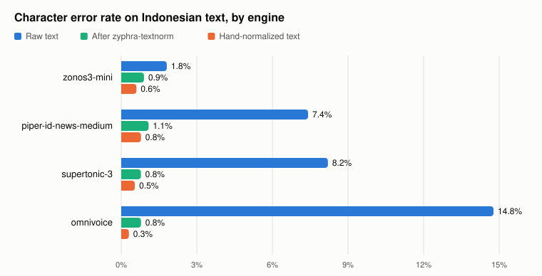

# tts-id-bench

[](LICENSE)


A benchmark of open-weight text-to-speech models on **Indonesian**, run on a laptop (Apple M2, 16 GB).

It measures whether a model reads everyday Indonesian text correctly: numbers, rupiah amounts, dates,
units, abbreviations, chat shorthand and English loanwords. It does not measure how natural the voice sounds.

<picture>
  <source media="(prefers-color-scheme: dark)" srcset="assets/results-dark.svg">
  
</picture>

**In short:** all four engines pronounce Indonesian well. What they get wrong is text such as `Rp15.000` or
`5/12/2026`, and putting an existing open-source normalizer in front of the engine fixes almost all of it.

## Contents

- [Findings](#findings)
- [What the errors look like](#what-the-errors-look-like)
- [Results by category](#results-by-category)
- [Listen](#listen)
- [Engines](#engines)
- [Test set](#test-set)
- [How it works](#how-it-works)
- [Running it](#running-it)
- [Limitations](#limitations)
- [Roadmap](#roadmap)
- [Contributing](#contributing)
- [Acknowledgements](#acknowledgements)
- [License](#license)

## Findings

Four engines, 28 sentences. Character error rate, lower is better.

| Engine | License | Speed on M2 | Raw text | After zyphra-textnorm | Hand-normalized text |
|---|---|---|---|---|---|
| [ZONOS3-Mini](https://huggingface.co/Zyphra/ZONOS3-Mini) | Apache-2.0 | 4x real time | 1.8% | 0.9% | 0.6% |
| [Piper `id_ID-news_tts-medium`](https://huggingface.co/rhasspy/piper-voices/tree/main/id/id_ID) | MIT (voice), GPL-3.0 (runtime) | 40x real time | 7.4% | 1.1% | 0.8% |
| [Supertonic-3](https://huggingface.co/Supertone/supertonic-3) | OpenRAIL-M | 4x real time | 8.2% | 0.8% | 0.5% |
| [OmniVoice](https://huggingface.co/k2-fsa/OmniVoice) | CC-BY-NC (weights) | 0.3x real time | 14.8% | 0.8% | 0.3% |

- **All four speak plain Indonesian clearly.** Once the text is written out in words, every engine is below 1%.
- **The differences come from text normalization, not from the voice.** On raw text, Piper, Supertonic-3
  and OmniVoice misread 7 to 15% of characters. Piper spells `Rp` as "er pe" and reads `/` as "garis miring";
  Supertonic-3 and OmniVoice garble large numbers and dates.
- **An existing open-source normalizer closes almost all of the gap.** Passing the text through
  [zyphra-textnorm](https://github.com/Zyphra/zyphra-textnorm) (MIT, `pip install zyphra-textnorm`) first brings
  every engine to about 1%. It has Indonesian rules for money, dates, times, units and common abbreviations.
  ZONOS3-Mini does well on raw text because its server already runs this normalizer.
- **What is still misread after normalization:** letter-by-letter acronyms (`KTP`, `BRI`) and chat shorthand
  (`dtg` for "datang"). No engine and no normalizer tested here handles those.

If you are building an Indonesian voice product on one of these engines, the practical takeaway is one line
in front of the synthesis call:

```python
import zyphra_textnorm

zyphra_textnorm.normalize("Total tagihan Anda Rp2.350.000, jatuh tempo 5/12/2026.", "id")
# 'Total tagihan Anda dua juta tiga ratus lima puluh ribu rupiah, jatuh tempo lima Desember dua ribu dua puluh enam.'
```

## What the errors look like

Raw text in, and what the literal speech recognizer wrote down from the audio. Its spelling is rough, so read
these as a description of what was said, not as exact transcripts.

| Written | Correct reading | Engine | What was said |
|---|---|---|---|
| `Rp15.000` | lima belas ribu rupiah | Piper | "er pe lima belas ribu" |
| `Rp2.350.000` | dua juta tiga ratus lima puluh ribu rupiah | Supertonic-3 | "er pe guarur igis lima puluh ribu" |
| `5/12/2026` | lima Desember dua ribu dua puluh enam | Piper | "lima garis miring dua belas garis miring dua ribu dua puluh enam" |
| `5/12/2026` | lima Desember dua ribu dua puluh enam | OmniVoice | "lampewan wampul lempu" |
| `80 km/jam` | delapan puluh kilometer per jam | Piper | "delapan puluh ka em garis miring jam" |
| `dr. Sari` | dokter Sari | Piper | "de er sari" |
| `a.n. Budi` | atas nama Budi | OmniVoice | "an budi" |
| `Yg penting dtg` | yang penting datang | Supertonic-3 | "ai penting deri" |

After zyphra-textnorm, every row above except the last is read correctly by all four engines. In the last row
`Yg` becomes "yang" but `dtg` is left as it is.

## Results by category

Character error rate in percent. Full tables, including hand-normalized text, are in [RESULTS.md](RESULTS.md).

**Raw text**

| Engine | plain | number | currency | datetime | unit | abbrev | homograph | codeswitch | long | informal |
|---|---|---|---|---|---|---|---|---|---|---|
| ZONOS3-Mini | 0.0 | 0.6 | 0.0 | 7.3 | 1.9 | 4.4 | 0.0 | 0.0 | 0.3 | 9.4 |
| Piper | 0.0 | 1.1 | 19.4 | 19.2 | 16.8 | 18.2 | 0.0 | 2.7 | 0.3 | 9.4 |
| Supertonic-3 | 0.0 | 7.4 | 27.1 | 13.9 | 14.8 | 21.2 | 0.9 | 0.7 | 0.0 | 10.6 |
| OmniVoice | 0.0 | 29.9 | 40.3 | 43.7 | 22.6 | 19.7 | 0.0 | 0.0 | 0.0 | 8.2 |

**After zyphra-textnorm**

| Engine | plain | number | currency | datetime | unit | abbrev | homograph | codeswitch | long | informal |
|---|---|---|---|---|---|---|---|---|---|---|
| ZONOS3-Mini | 0.0 | 0.6 | 0.0 | 0.7 | 1.9 | 4.4 | 0.0 | 0.0 | 0.3 | 3.5 |
| Piper | 0.0 | 0.0 | 1.4 | 1.3 | 0.6 | 2.9 | 0.0 | 2.7 | 0.3 | 4.7 |
| Supertonic-3 | 0.0 | 0.0 | 0.7 | 0.0 | 0.0 | 3.6 | 0.9 | 0.7 | 0.0 | 5.9 |
| OmniVoice | 0.0 | 1.7 | 0.0 | 0.0 | 0.7 | 3.6 | 0.0 | 0.0 | 0.0 | 4.7 |

Plain sentences, long sentences and English loanwords are not a problem for any engine. The errors sit in
`currency`, `datetime`, `unit`, `abbrev` and `informal`, and after normalization only `abbrev` and `informal`
remain above 2%. The `homograph` column reads 0 because neither judge can tell the two readings of `apel`
apart: see [Limitations](#limitations).

## Listen

**[Audio samples page](https://rmaw22.github.io/tts-id-bench/)**: six sentences read by each engine, raw and
hand-normalized, each with its error rate and what the recognizer heard. A few clips to start with:

| Sentence | Engine | Raw | Hand-normalized |
|---|---|---|---|
| `Total tagihan Anda Rp2.350.000, jatuh tempo besok.` | Piper | [clip](https://rmaw22.github.io/tts-id-bench/samples/piper-id-news-medium/raw/currency-02.mp3) | [clip](https://rmaw22.github.io/tts-id-bench/samples/piper-id-news-medium/normalized/currency-02.mp3) |
| | ZONOS3-Mini | [clip](https://rmaw22.github.io/tts-id-bench/samples/zonos3-mini/raw/currency-02.mp3) | [clip](https://rmaw22.github.io/tts-id-bench/samples/zonos3-mini/normalized/currency-02.mp3) |
| `Batas pendaftaran 5/12/2026.` | Supertonic-3 | [clip](https://rmaw22.github.io/tts-id-bench/samples/supertonic-3/raw/datetime-02.mp3) | [clip](https://rmaw22.github.io/tts-id-bench/samples/supertonic-3/normalized/datetime-02.mp3) |
| | OmniVoice | [clip](https://rmaw22.github.io/tts-id-bench/samples/omnivoice/raw/datetime-02.mp3) | [clip](https://rmaw22.github.io/tts-id-bench/samples/omnivoice/normalized/datetime-02.mp3) |
| `Yg penting dtg dulu aja, sisanya gampang.` | Piper | [clip](https://rmaw22.github.io/tts-id-bench/samples/piper-id-news-medium/raw/informal-02.mp3) | [clip](https://rmaw22.github.io/tts-id-bench/samples/piper-id-news-medium/normalized/informal-02.mp3) |

[](https://rmaw22.github.io/tts-id-bench/)

## Engines

| Engine | Voice used | Runtime | Notes |
|---|---|---|---|
| ZONOS3-Mini | cloned from a reference clip | its own MLX server | Normalizes text itself with zyphra-textnorm. Apple Silicon only in this setup. |
| Piper `id_ID-news_tts-medium` | the voice's single speaker | ONNX on CPU | The only one with a dedicated Indonesian voice. The voice is MIT, the `piper-tts` runtime is GPL-3.0, and the provenance of the voice's training data is unclear. |
| Supertonic-3 | preset `F1` | ONNX on CPU | Multilingual, run with `lang="id"`. |
| OmniVoice | cloned from a reference clip | PyTorch on MPS, fp16 | Slowest by far on this machine. Weights are non-commercial. |

The two voice-cloning engines are given the same reference: a clip synthesized by Piper, so no real person's
voice is used.

## Test set

`data/sentences.json`, 28 sentences in 10 categories:

| Category | Sentences | Example |
|---|---|---|
| `plain` | 3 | `Apakah kamu sudah makan siang, atau mau pesan sekalian?` |
| `number` | 3 | `Tahun ini ada 1.250 peserta dari 34 provinsi.` |
| `currency` | 3 | `Anggarannya mencapai Rp1,2 triliun.` |
| `datetime` | 3 | `Rapat digeser ke jam 14.00.` |
| `unit` | 3 | `Beratnya 2,5 kg dan panjangnya 30 cm.` |
| `abbrev` | 3 | `Bawa KTP, SIM, dll. saat datang ke kantor BRI.` |
| `homograph` | 3 | `Setelah apel pagi, ia makan apel di teras.` |
| `codeswitch` | 3 | `Meeting-nya di-reschedule, nanti link Zoom dikirim via email.` |
| `long` | 2 | A single sentence of about 30 words. |
| `informal` | 2 | `Gue udah bilang dari kemarin, tapi dia nggak mau dengerin.` |

Each sentence has three forms:

```json
{
  "id": "currency-01",
  "category": "currency",
  "text": "Harganya Rp15.000 per porsi.",
  "spoken": "harganya lima belas ribu rupiah per porsi",
  "normalized": "Harganya lima belas ribu rupiah per porsi."
}
```

- `text`: as written.
- `normalized`: written out by hand, as a perfect normalizer would.
- `spoken`: the correct reading, used as the answer key.

## How it works

1. `synth` runs each sentence through each engine in three variants: **raw** (`text` as written), **textnorm**
   (`text` after zyphra-textnorm) and **normalized** (the hand-written form).
2. `score` transcribes every clip back to text with two speech recognizers and compares it with `spoken`.
3. `chart` and `samples` turn the scores into the chart above and the listening page.

The gap between raw and normalized shows how much of an engine's error comes from unnormalized text rather than
from its speech. The textnorm column shows how much of that gap an existing normalizer already closes.

### Why two judges

Whisper is accurate, but it tidies what it hears: "lima belas ribu rupiah" and "er pe lima belas ribu" can both
come back as `Rp15.000`. With Whisper alone, a correct reading of an abbreviation cannot be told from a wrong one.

The second judge is a character-level wav2vec2 model with no language model. Its spelling is rougher, but it
writes what was actually said ("er pe", "garis miring").

A clip's score is the lower of the two judges' character error rates, with spaces ignored. A correct reading is
credited if either judge hears it; a wrong reading is still caught because neither does. Both transcripts are
kept in `out/results.json`.

| Judge | Model |
|---|---|
| Whisper | [faster-whisper](https://github.com/SYSTRAN/faster-whisper) `large-v3-turbo` |
| Literal | [`indonesian-nlp/wav2vec2-indonesian-javanese-sundanese`](https://huggingface.co/indonesian-nlp/wav2vec2-indonesian-javanese-sundanese), greedy decoding |

### Metrics

- **Character error rate (CER):** edit distance between the expected reading and the transcript, divided by the
  length of the expected reading. Per-engine figures are weighted by sentence length.
- **Speed:** audio seconds produced per second of computing, excluding model load and the first sentence.
  "4x real time" means one second of audio takes a quarter of a second to make.

## Running it

Requirements:

- [uv](https://docs.astral.sh/uv/) and ffmpeg.
- Python 3.12 or newer (uv installs it).
- For ZONOS3-Mini: a Mac with Apple Silicon. The other three engines also run elsewhere, but only macOS on an
  M2 has been tested.
- About 20 GB of free disk for the models, more than half of it ZONOS3-Mini.

```sh
git clone https://github.com/rmaw22/tts-id-bench.git
cd tts-id-bench
uv sync
uv run python -m tts_id_bench.synth          # all engines, or name the ones you want
uv run python -m tts_id_bench.score          # writes out/results.json and RESULTS.md
uv run python -m tts_id_bench.chart          # writes assets/results-*.svg
uv run python -m tts_id_bench.samples        # writes docs/ (the samples page)
```

To try it without the large downloads, run only the two small engines:

```sh
uv run python -m tts_id_bench.synth piper-id-news-medium supertonic-3
```

ZONOS3-Mini runs through its own MLX server, which has to be installed first:

```sh
git clone --recurse-submodules https://github.com/Zyphra/ZONOS3-Mini.git vendor/ZONOS3-Mini
cd vendor/ZONOS3-Mini
uv sync --locked --package zonos3-mlx
uv run --package zonos3-mlx hf download Zyphra/ZONOS3-Mini --include 'gguf/*' --local-dir servers/ggml
```

On the M2, synthesis of all four engines takes about 20 minutes, most of it OmniVoice. Scoring all 336
clips for the first time took about 50 minutes with the laptop short on memory. Both steps skip work that is
already done: `synth` keeps existing clips, and `score` only transcribes clips that are new, so a re-run takes
seconds. Delete `out/<engine>` to redo an engine from scratch.

### Project layout

```
data/sentences.json          test sentences and answer key
src/tts_id_bench/
  engines.py                 one class per engine
  synth.py                   text -> out/<engine>/<variant>/<id>.wav
  score.py                   clips -> out/results.json, RESULTS.md
  chart.py                   results -> assets/results-*.svg
  samples.py                 results -> docs/ (listening page and MP3s)
RESULTS.md                   generated tables
docs/                        generated listening page
```

`out/`, `models/` and `vendor/` are created locally and are not in the repository.

### Adding an engine

Subclass `Engine` in `src/tts_id_bench/engines.py`, implement `load()` and `synthesize()`, and register it in
`ENGINES`:

```python
class MyEngine(Engine):
    name = "my-engine"
    license = "Apache-2.0"
    url = "https://huggingface.co/..."
    voice = "default"

    def load(self) -> None:
        ...  # download and load the model

    def synthesize(self, text: str, out_path: Path) -> None:
        ...  # write a WAV file to out_path
```

### Adding sentences

Add an entry to `data/sentences.json` with all five fields. Write `spoken` in lowercase words only, with
numbers and abbreviations fully spelled out the way a careful native speaker would read them.

## Limitations

- **Small test set.** 28 sentences written by one person, each synthesized once. Enough to see the pattern,
  not enough to rank engines that are close.
- **One accepted reading per sentence.** ZONOS3-Mini reads `pukul 07.30` as "pukul tujuh lewat tiga puluh menit",
  which is correct but does not match the answer key, so it is penalized.
- **Best-of-two scoring is slightly optimistic.** This applies equally to every engine.
- **Homographs are not measured.** `apel` (fruit) and `apel` (roll call) are spelled the same by both judges,
  so that category has to be judged by ear.
- **Naturalness is not measured.** A flat, robotic voice that says the right words scores the same as a
  natural one.
- **Voice-cloning engines share one synthetic reference.** OmniVoice and ZONOS3-Mini have no Indonesian preset
  voice, so both clone a clip synthesized by Piper. A different reference may give different results.
- **Speed is measured on one machine**, and each engine uses its own runtime (ONNX, MPS, MLX). The figures
  vary from run to run with how busy the laptop is.

## Roadmap

- Grow the test set to about 100 sentences, with more acronyms and chat shorthand.
- Accept more than one correct reading per sentence.
- Show the zyphra-textnorm variant on the listening page.
- Add engines as open-weight models with Indonesian support appear.
- A listening test for homographs and naturalness.

## Contributing

Issues and pull requests are welcome, especially new test sentences, corrections to the answer key and new
engines. Please keep commits in [Conventional Commits](https://www.conventionalcommits.org/) style and one
topic per pull request.

## Acknowledgements

This benchmark only measures other people's work:

- TTS engines: [Piper](https://github.com/OHF-Voice/piper1-gpl), [Supertonic](https://huggingface.co/Supertone/supertonic-3),
  [OmniVoice](https://huggingface.co/k2-fsa/OmniVoice) and [ZONOS3-Mini](https://huggingface.co/Zyphra/ZONOS3-Mini).
- Text normalization: [zyphra-textnorm](https://github.com/Zyphra/zyphra-textnorm).
- Judges: [faster-whisper](https://github.com/SYSTRAN/faster-whisper) with OpenAI's Whisper `large-v3-turbo`, and the
  [Indonesian wav2vec2 model](https://huggingface.co/indonesian-nlp/wav2vec2-indonesian-javanese-sundanese) by indonesian-nlp.
- Scoring: [jiwer](https://github.com/jitsi/jiwer) and [num2words](https://github.com/savoirfairelinux/num2words).

## License

Code and test sentences are released under the [MIT License](LICENSE).

The clips under `docs/samples/` are machine-generated speech produced by the engines listed above and are
included for evaluation only. Each engine's own license applies to its output; note that the OmniVoice weights
are CC-BY-NC.

The engines and judges are installed as dependencies and keep their own licenses. In particular the `piper-tts`
package is GPL-3.0-or-later, which matters if you redistribute this code together with it.
