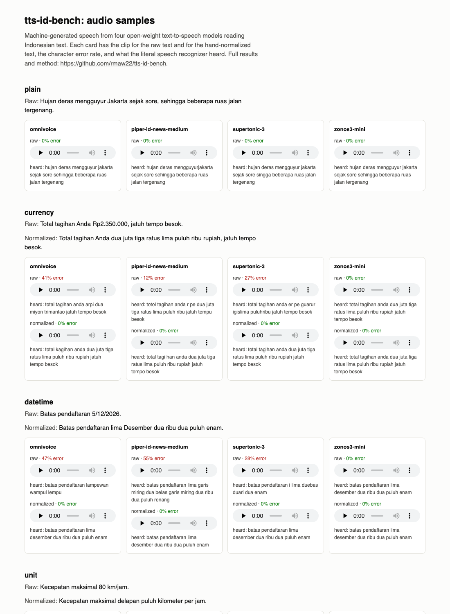

# tts-id-bench

A benchmark of open-weight text-to-speech models on **Indonesian**, run on a laptop (Apple M2, 16 GB).

It measures whether a model reads everyday Indonesian text correctly: numbers, rupiah amounts, dates,
units, abbreviations, chat shorthand and English loanwords. It does not measure how natural the voice sounds.

<picture>
  <source media="(prefers-color-scheme: dark)" srcset="assets/results-dark.svg">
  
</picture>

## Findings so far

Four engines, 28 sentences. Character error rate, lower is better.

| Engine | License | Speed on M2 | Raw text | Hand-normalized text |
|---|---|---|---|---|
| [ZONOS3-Mini](https://huggingface.co/Zyphra/ZONOS3-Mini) | Apache-2.0 | 6x real time | 1.8% | 0.6% |
| [Piper `id_ID-news_tts-medium`](https://huggingface.co/rhasspy/piper-voices/tree/main/id/id_ID) | MIT | 40x real time | 7.4% | 0.8% |
| [Supertonic-3](https://huggingface.co/Supertone/supertonic-3) | OpenRAIL-M | 4x real time | 8.2% | 0.5% |
| [OmniVoice](https://huggingface.co/k2-fsa/OmniVoice) | CC-BY-NC (weights) | 0.3x real time | 14.8% | 0.3% |

- **All four speak plain Indonesian clearly.** Once the text is written out in words, every engine is below 1%.
- **The differences come from text normalization, not from the voice.** On raw text, Piper, Supertonic-3
  and OmniVoice misread 7 to 15% of characters. Piper spells `Rp` as "er pe" and reads `/` as "garis miring";
  Supertonic-3 and OmniVoice garble large numbers and dates.
- **ZONOS3-Mini is the exception because it ships a normalizer.** Its server runs
  [zyphra-textnorm](https://github.com/Zyphra/zyphra-textnorm), which has Indonesian rules for money, time,
  units and abbreviations.
- **Nobody handles chat shorthand.** `Yg penting dtg dulu` is not read as "yang penting datang dulu" by any engine.

Per-category tables are in [RESULTS.md](RESULTS.md). These are early numbers: see [Limitations](#limitations).

## Listen

**[Audio samples page](https://rmaw22.github.io/tts-id-bench/)**: the same sentences read by each engine, raw
and normalized, with the error rate and what the speech recognizer heard.

[](https://rmaw22.github.io/tts-id-bench/)

## How it works

1. `data/sentences.json` holds the test sentences. Each has three forms:
   - `text`: as written, e.g. `Harganya Rp15.000 per porsi.`
   - `normalized`: written out by hand as a perfect normalizer would, e.g. `Harganya lima belas ribu rupiah per porsi.`
   - `spoken`: the correct reading, used as the answer key.
2. `synth` runs `text` (the **raw** variant) and `normalized` (the **normalized** variant) through each engine.
3. `score` transcribes every clip back to text with two speech recognizers and compares it with `spoken`.

The gap between the raw and normalized columns shows how much of an engine's error comes from unnormalized
text rather than from its speech.

Categories: `plain`, `number`, `currency`, `datetime`, `unit`, `abbrev`, `homograph`, `codeswitch`, `long`, `informal`.

### Why two judges

Whisper is accurate, but it tidies what it hears: "lima belas ribu rupiah" and "er pe lima belas ribu" can both
come back as `Rp15.000`. With Whisper alone, a correct reading of an abbreviation cannot be told from a wrong one.

The second judge is a character-level wav2vec2 model with no language model. Its spelling is rougher, but it
writes what was actually said ("er pe", "garis miring").

A clip's score is the lower of the two judges' character error rates, with spaces ignored. A correct reading is
credited if either judge hears it; a wrong reading is still caught because neither does. Both transcripts are
kept in `out/results.json`.

## Running it

Requires [uv](https://docs.astral.sh/uv/) and ffmpeg. Models are downloaded on first use (several GB in total).

```sh
uv sync
uv run python -m tts_id_bench.synth          # all engines, or name the ones you want
uv run python -m tts_id_bench.score          # writes out/results.json and RESULTS.md
uv run python -m tts_id_bench.chart          # writes assets/results-*.svg
uv run python -m tts_id_bench.samples        # writes docs/ (the samples page)
```

ZONOS3-Mini runs through its own MLX server, which has to be installed first:

```sh
git clone --recurse-submodules https://github.com/Zyphra/ZONOS3-Mini.git vendor/ZONOS3-Mini
cd vendor/ZONOS3-Mini
uv sync --locked --package zonos3-mlx
uv run --package zonos3-mlx hf download Zyphra/ZONOS3-Mini --include 'gguf/*' --local-dir servers/ggml
```

### Adding an engine

Subclass `Engine` in `src/tts_id_bench/engines.py`, implement `load()` and `synthesize()`, and register it in `ENGINES`.

## Limitations

- **Small test set.** 28 sentences written by one person, each synthesized once. Enough to see the pattern,
  not enough to rank engines that are close.
- **One accepted reading per sentence.** ZONOS3-Mini reads `pukul 07.30` as "pukul tujuh lewat tiga puluh menit",
  which is correct but does not match the answer key, so it is penalized.
- **Best-of-two scoring is slightly optimistic.** This applies equally to every engine.
- **Homographs are not measured.** `apel` (fruit) and `apel` (roll call) are spelled the same by both judges,
  so that category has to be judged by ear.
- **Voice-cloning engines share one synthetic reference.** OmniVoice and ZONOS3-Mini have no Indonesian preset
  voice, so both clone a clip synthesized by Piper. A different reference may give different results.
- **Speed is measured on one machine**, and each engine uses its own runtime (ONNX, MPS, MLX).

## License

Code and test sentences are released under the [MIT License](LICENSE).

The clips under `docs/samples/` are machine-generated speech produced by the engines listed above and are
included for evaluation only. Each engine's own license applies to its output; note that the OmniVoice weights
are CC-BY-NC.
